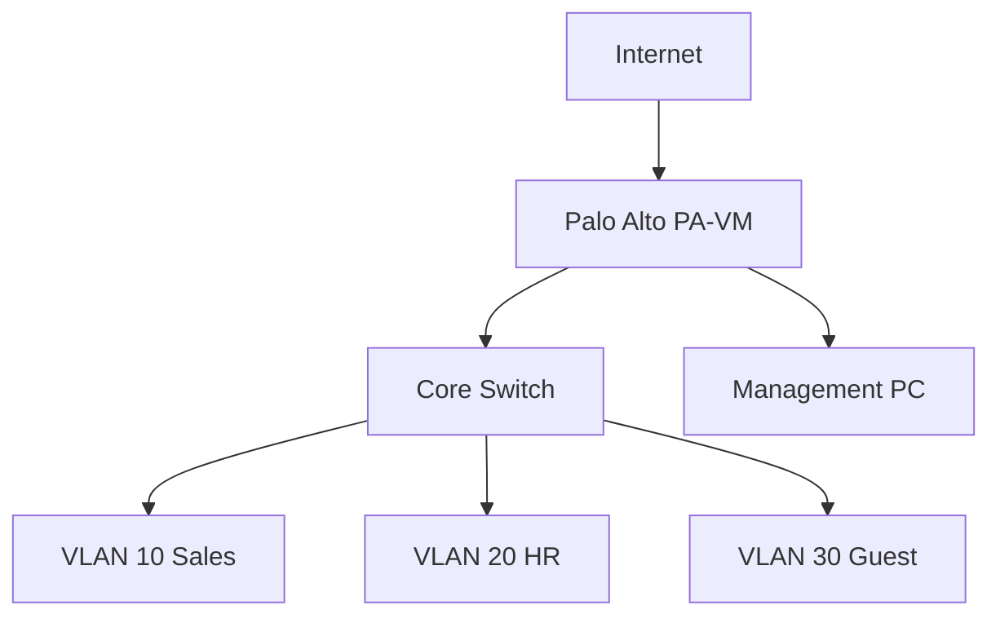

# Palo Alto Firewall Labs

Status - Lab template to be completed. This repo is a hands-on lab plan for learning Palo Alto firewalls. It is not production experience and it is not a completed project. Work through the labs, take your own screenshots, and update the status line of each lab as you finish it.

## Objective

Build a Palo Alto lab in GNS3 or EVE-NG with a PA-VM image, or on a trial VM. Learn zones, security policies, NAT, App-ID, URL filtering, and a site-to-site IPsec VPN. The goal is to get comfortable with the PAN-OS way of doing things, where everything is zone based and every rule has a clear purpose.

## Architecture



## Technologies used

- Palo Alto PA-VM and PAN-OS
- GNS3 or EVE-NG
- Zones, security policies, NAT, App-ID, URL filtering
- IPsec VPN, IKEv2
- Cisco 2960 and 3850 switches for the lab LAN
- Wireshark for checking what the firewall lets through

## Lab topology

- Untrust zone on ethernet1/1, WAN address 203.0.113.2/30, gateway 203.0.113.1
- Trust zone on ethernet1/2, LAN address 192.168.10.1/24
- Guest zone on ethernet1/3, LAN address 192.168.30.1/24
- Management on the dedicated management interface, address 192.168.99.1/24
- One branch site at 203.0.113.10 with LAN 192.168.20.0/24 for the VPN lab

## Configuration examples

Set the interfaces and zones.

```
set network interface ethernet ethernet1/1 layer3 ip 203.0.113.2/30
set network interface ethernet ethernet1/2 layer3 ip 192.168.10.1/24
set network interface ethernet ethernet1/3 layer3 ip 192.168.30.1/24
set zone untrust network layer3 [ ethernet1/1 ]
set zone trust network layer3 [ ethernet1/2 ]
set zone guest network layer3 [ ethernet1/3 ]
```

Put the interfaces in the default virtual router and add a default route.

```
set network virtual-router default interface [ ethernet1/1 ethernet1/2 ethernet1/3 ]
set network virtual-router default routing-table ip static-route Default-Route nexthop ip-address 203.0.113.1 interface ethernet1/1 destination 0.0.0.0/0
```

Allow web browsing from trust to untrust with App-ID.

```
set rulebase security rules Allow-Web from trust to untrust source any destination any application web-browsing service application-default action allow
```

Allow DNS from trust to untrust.

```
set rulebase security rules Allow-DNS from trust to untrust source any destination any application dns service application-default action allow
```

Block the guest zone from reaching the trust zone.

```
set rulebase security rules Block-Guest-to-Trust from guest to trust source any destination any application any service any action deny
```

Set up outbound NAT for the trust zone.

```
set rulebase nat rules Outbound-NAT from trust to untrust source 192.168.10.0/24 destination any source-translation dynamic-ip-and-port interface-address interface ethernet1/1
```

Build the site-to-site VPN to the branch.

```
set network ike gateway HQ-GW authentication pre-shared-key key <redacted> protocol ikev2 dpd enable peer-address ip 203.0.113.10 local-address interface ethernet1/1 local-address ip 203.0.113.2
set network tunnel ipsec HQ-Tunnel auto-key ike-gateway HQ-GW auto-key proxy-id local 192.168.10.0/24 remote 192.168.20.0/24 protocol any
set rulebase security rules Allow-VPN-Traffic from trust to untrust source 192.168.10.0/24 destination 192.168.20.0/24 application any service any action allow
```

Commit every change.

```
commit
```

## Implementation steps

1. Load the PA-VM image in GNS3 or EVE-NG and boot it
2. Set the management interface address and log in to the web interface
3. Build the interfaces and zones from the examples above
4. Add the default route and the first two security rules
5. Commit and test a ping from a trust host to the WAN gateway
6. Add the NAT rule, commit, and test web browsing from a trust host
7. Add the guest zone rules and test that a guest host cannot reach the trust LAN
8. Build the VPN gateway and tunnel, commit, and test traffic to the branch LAN

## Verification commands

```
show system info
show interface all
show routing route
test security-policy-match from trust to untrust source 192.168.10.5 destination 203.0.113.50 protocol 6 destination-port 443
show session all filter source 192.168.10.5
show vpn ipsec-sa tunnel HQ-Tunnel
show vpn ike-sa gateway HQ-GW
```

## Troubleshooting scenarios

- Traffic is dropped and no rule matches, so run the security policy match test above and check the rule order, since Palo Alto checks rules top to bottom
- A host can ping the gateway but cannot browse, so check the NAT rule and confirm the security rule allows the web-browsing application, not just port 80
- The VPN tunnel stays down, so check the peer address and pre-shared key on both sides, then check the IKE phase 1 proposal matches
- Phase 1 is up but no traffic flows, so check the proxy ID subnets on both sides and confirm a security rule allows the VPN traffic
- A commit fails, so read the commit error, fix the named object, and commit again

## Security best practices

- Deny by default and allow only what the business needs
- Use App-ID instead of port based rules wherever you can
- Keep the guest zone separate from the trust zone with no path between them
- Log traffic at session end so you can review what passed and what was dropped
- Use a strong pre-shared key for the VPN and store it safely, never in a screenshot
- Review the rules every month and remove anything that is no longer used

## Learning outcomes

- Build zones and interfaces on PAN-OS from the command line
- Write security rules that use applications instead of ports
- Set up NAT so inside hosts reach the internet
- Build a working site-to-site IPsec VPN
- Test a policy match before you blame the network

## Screenshot placeholders

- screenshots/dashboard.png - Placeholder, add a screenshot of the PAN-OS dashboard after the first commit
- screenshots/security-rules.png - Placeholder, add a screenshot of the security rule list
- screenshots/vpn-status.png - Placeholder, add a screenshot of the VPN tunnel status once it is up

## Project status

Lab template to be completed. No lab in this repo is finished yet. Update this section as each lab is done.
